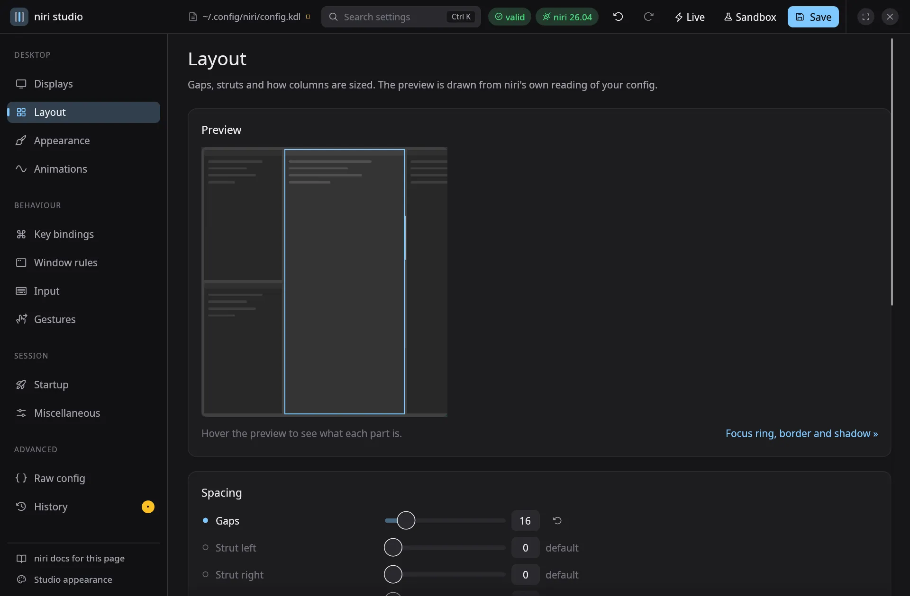

# niri studio

[](https://github.com/ulaas/niri-studio/actions/workflows/ci.yml)

A Wayland-native visual editor for [niri](https://github.com/niri-wm/niri)'s `config.kdl`,
written in Rust with egui. **[See the tour →](https://ulaas.github.io/niri-studio/)**



- **Keeps your file intact.** Edits are spliced into the text; comments, ordering and
  formatting you wrote are never rewritten. Everything written is KDL v1, which niri reads.
- **niri is the judge.** Every change is re-parsed with niri's own `niri-config` crate (built
  from your niri checkout), so errors are exactly what niri would report, with line links.
- **Safe apply.** Saving is atomic and backs up the previous file. If niri reports that the
  reload failed, the backup is restored automatically. Display changes revert after 15 seconds
  unless you confirm them.

## Pages

| Page | What it does |
|---|---|
| Displays | Drag monitors with edge snapping; mode, scale, rotation, VRR, with a timed revert |
| Layout | Live workspace preview drawn from niri's parsed layout; gaps, struts, column/height presets |
| Appearance | Focus ring, border (solid or gradient with angle dial), shadow, tabs, cursor, blur |
| Animations | Spring and easing editors with niri's curve maths, draggable cubic-bézier handles, live demo |
| Key bindings | Search, duplicate-combination warnings, key recorder, action picker, ▶ run now |
| Window rules | Quick rules: click a button, then click a window. Rename, enable/disable (`/-`), reorder, duplicate, delete; a live list of the windows each rule matches |
| Input, Gestures, Misc | Forms generated from the option schema |
| Startup | `spawn-at-startup`, `spawn-sh-at-startup`, environment variables |
| Raw config | Highlighted editor with niri's diagnostics, synced with the visual pages |
| History | Review unsaved changes, diff and restore earlier saved versions |

Ctrl+K searches every setting; Ctrl+S saves; Ctrl+Z / Ctrl+Shift+Z undo and redo across all
pages. **Live** applies each valid change to niri as you make it.

**Sandbox** tries your edits before they touch anything: it opens niri nested as a window,
running a private copy of the config in `$XDG_RUNTIME_DIR`, and mirrors every valid edit into
it as you make it (unsaved includes too). Your config file and the running session stay
untouched until you save. Startup programs are left out unless you ask for them, a couple of
terminals open so layout and decorations have something to show, and inside the window Mod is
Alt. The nested niri exits with the app.

**Studio appearance** (sidebar) picks the app's own theme: follow the system, Studio
Dark/Light, Catppuccin, Tokyo Night, Rosé Pine, Nord or Gruvbox; an accent that follows your
focus ring, the theme's or a custom color; density; corner radius; the desktop's font; and
whether the app draws its own title bar (drag to move, double-click to maximize, themed window
controls) or asks the compositor for decorations.
Saved to `~/.config/niri-studio/studio.conf`.

A rule's name is a `// comment` line directly above it; disabling a rule comments it out
with KDL's `/-`, so it stays in the file.

## Building

niri-studio depends on `../niri/niri-config` and `../niri/niri-ipc` (the niri checkout next to
this one), so its view of the config always matches the niri you run.

```sh
./install.sh            # release build → ~/.local/bin/niri-studio + desktop entry
cargo test --workspace  # round-trips real configs; checks every option against niri's parser
```

`edge-update` rebuilds it whenever either niri-studio or niri gets new commits.

## Layout

- `crates/doc`: format-preserving document model (splices, undo, includes, labels, `/-`), save/backup, validation
- `crates/schema`: option catalogue, verified against niri's parser in tests
- `crates/live`: niri IPC (event stream, outputs, window picker, running actions)
- `crates/app`: the egui application (`theme.rs` holds palettes and the style built from
  them; widgets take colors from `theme::pal` rather than hard-coding them)

For UI work, `NIRI_STUDIO_SHOT=<Page>=/tmp/x.png niri-studio <config>` renders a page to a PNG
and exits (`NIRI_STUDIO_SELECT=<n>` preselects an item, `NIRI_STUDIO_SEARCH=<query>` opens
the search palette, `NIRI_STUDIO_APPEARANCE=1` the appearance panel). `NIRI_STUDIO_SANDBOX=1`
starts with the sandbox running.

`site/` is the project page, published to GitHub Pages by `.github/workflows/pages.yml`;
`site/shots.sh` regenerates its screenshots from niri's default config.

## License

GPL-3.0-or-later, like niri. niri studio is an independent project, not affiliated with niri.
Security issues: see [SECURITY.md](SECURITY.md).
